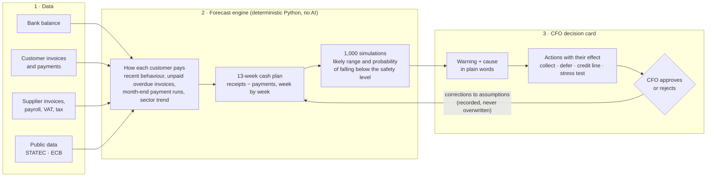

# Headroom Monitor

**Spotting a cash shortage before it happens.**
A 13-week cash forecast and early-warning module for an SME finance team, built for the
LHoFT Best Case Study Competition 2026 — case *Financial Navigator by A352*.

The forecast tells the CFO, every week, how much cash the company will have at the end of each of
the next 13 weeks, how sure we are, **why** a shortfall is coming and **what can be done about it**.
Every action needs the CFO's approval.

> All data is synthetic: a fictional Luxembourg building-supplies distributor ("DemoCo",
> ~€25m revenue, 237 customers, 25 suppliers) generated on top of real public statistics
> (STATEC bankruptcies, ECB rates). Customers are pseudonymised as `CUST_###`.

## Submission at a glance

| | |
|---|---|
| **Live demo** | <https://headroom-monitor.netlify.app> (copy: <https://sharkolsdj.github.io/headroom-monitor/>) |
| **Illustrative dataset** | Case study S2, Excel, CSV and README: [`data/illustrative/S2/`](data/illustrative/S2) (all scenarios in [`data/illustrative/`](data/illustrative)) |
| **Video** | <https://sharkolsdj.github.io/headroom-monitor/video/headroom-monitor.mp4> |
| **Proposal (3 pages)** | [`submission/Headroom_Monitor_Proposal.pdf`](submission/Headroom_Monitor_Proposal.pdf) |
| **Presentation slides** | [`submission/Headroom_Monitor_Presentation.pdf`](submission/Headroom_Monitor_Presentation.pdf) |

---

## How it works



| Step | What happens | Where in the code |
|---|---|---|
| 1. Data | Invoices, payments, bank balances and recurring costs are loaded into PostgreSQL. Public data comes from STATEC (LUSTAT) and the ECB. | `ingestion/`, `migrations/` |
| 2. Engine | Estimates when each open invoice will be paid, adds future sales and all payments, and simulates 1,000 possible futures. | `engine/` |
| 3. Outputs | Forecast, customer ledger, collection list, profit-vs-cash bridge, list of every assumption. | `data/demo/<scenario>/` |
| 4. Decision card | Static web page that explains the warning and lets the CFO test and approve actions. | `frontend/demo/` |
| 5. Validation | Compares the forecast with a hidden future the engine never sees. | `tracker/backtest.py`, `scripts/run_holdout.py` |

### Design principles

- **Numbers are computed, never generated.** All cash figures come from deterministic code. AI is used only to put the warning into words, and every figure in that text comes from the engine.
- **The CFO decides.** The system suggests; nothing is executed without approval. CFO corrections are stored insert-only with who, when and why (`hm.assumption_overrides`, audit trigger).
- **Uncertainty is shown, not hidden.** Each week has a likely range and a probability of falling below the safety level (4 weeks of fixed costs, ≈ €510k).
- **Profit is not cash.** A monthly bridge explains why a profitable month can still drain the bank account, reconciled to the cent.
- **Honest validation.** Targets were written down before building (`docs/PHASE3_PREREG.md`); every later change is logged; the final test ran once on scenarios generated after the engine was frozen.

---

## Results (engine tag `phase3-frozen-r1`)

| Test | Result |
|---|---|
| Large customer slowing down (S2) | Shortfall flagged in the exact week it happened (week 6) |
| **Unseen test, customer drift (H1)** | **Shortfall flagged one week before it happened (week 6 vs 7)** |
| Payment spike (S4) | Spike week identified exactly (week 7) |
| Normal scenarios (S1, S5–S8) | No false alarms |
| Week-1 forecast error | Within 10% in 6 of 8 development scenarios |
| Sector crisis (S3, unseen H2) | Sector warning fires on the right segment, but the size of the drop is underestimated → the CFO gets a sector stress test |

Full results, deviations and limitations: [`docs/PROGRESS_PHASE_2_3.md`](docs/PROGRESS_PHASE_2_3.md).

---

## The scenarios

| ID | What is hidden in the future |
|---|---|
| S1 | Normal quarter |
| S2 | A large customer pays later and later; winter-stock bill in early November |
| S3 | Construction customers slow down; two small bankruptcies |
| S4 | Supplier bill, payroll charges and VAT in the same week |
| S5 | Seasonal slowdowns (August, December) |
| S6 | New customer that turns out to be a slow payer |
| S7 | Customers paying invoices in two parts |
| S8 | Accountant closes the month late, with corrections |
| H1, H2 | Unseen tests generated at random after the engine was frozen (seed 4242) |

---

## Repository map

```
engine/       Forecast engine: payment behaviour, 13-week plan, Monte Carlo, stress, bridge, assumptions
ingestion/    Public data loaders and the synthetic company generator
migrations/   PostgreSQL schema, roles, audit trigger, encrypted vault
config/       Company parameters and stress scenarios
scripts/      One-command runs: run_all.py, run_holdout.py, export_actuals.py, build_demo_data.py
tracker/      Backtest against the hidden future
data/demo/    Engine outputs per scenario (forecast, customers, collections, actuals)
frontend/demo Static CFO demo page
docs/         Specifications, pre-registration, progress reports, data protection
tests/        Automated tests (202)
```

## Reproduce

```
docker compose up -d                   # PostgreSQL 16 on port 5433
python scripts/migrate.py              # schema, roles, protections
python -m ingestion.public_data        # STATEC + ECB
python -m ingestion.generator --all    # fictional company and 8 scenarios
python scripts/run_all.py              # forecasts, charts, accuracy summary
python scripts/run_holdout.py          # unseen tests H1, H2
python scripts/export_actuals.py       # actual weekly balances (evaluator role)
python scripts/build_demo_data.py      # data for the demo page
python -m pytest -q                    # tests
```

Notes on the tests:
- Run the test suite **once at a time**. Some tests regenerate the synthetic datasets inside the database, so two runs in parallel can overwrite each other's data.
- One failure is known and declared: `test_acceptance_check_passes[S2_big_customer]`. The check was written for the Phase 2 engine; with the frozen engine the "all paid on time" line dips just below the safety level in week 12. The check is kept unchanged; see [`docs/PROGRESS_PHASE_2_3.md`](docs/PROGRESS_PHASE_2_3.md), section 3c.

Project rules for contributors and coding agents: [CLAUDE.md](CLAUDE.md).
