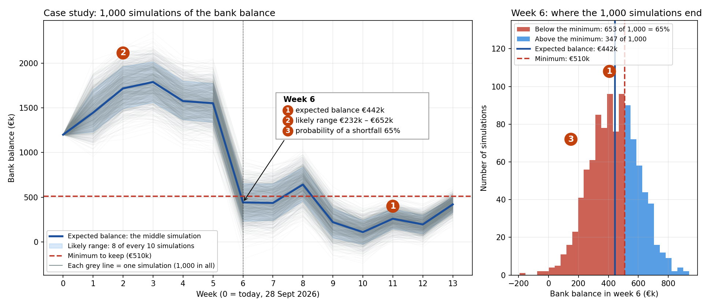

# Supplementary figure: the 1,000 simulations of the case study

**Case study (DemoCo, forecast made on 28 September 2026): 1,000 simulations of the bank balance.**
Each grey line is one simulation of the next 13 weeks: in each one, every customer pays on a date drawn from its own past payments. The red dashed line is the minimum DemoCo must keep (€510k, four weeks of fixed costs). For each week, the 1,000 simulations give three results:

1. **Expected balance** (blue line, badge 1): the balance in the middle of the 1,000 simulations; half of them end above it, half below.
2. **Likely range** (blue band, badge 2): the band that contains 8 of every 10 simulations, leaving out the most extreme ones.
3. **Probability of a shortfall** (right panel, red bars, badge 3): how many of the 1,000 simulations end below the minimum. In week 6, when the supplier bills fall due, 653 of 1,000 do: a 65% probability.

In week 6: (1) expected balance €442k · (2) likely range €232k–€652k · (3) probability of a shortfall 65%.

All data are synthetic. The figure is made by [scripts/mc_paths_figure.py](../../scripts/mc_paths_figure.py) from the engine's own Monte Carlo (1,000 runs, seed 42); its values match the demo week by week.
